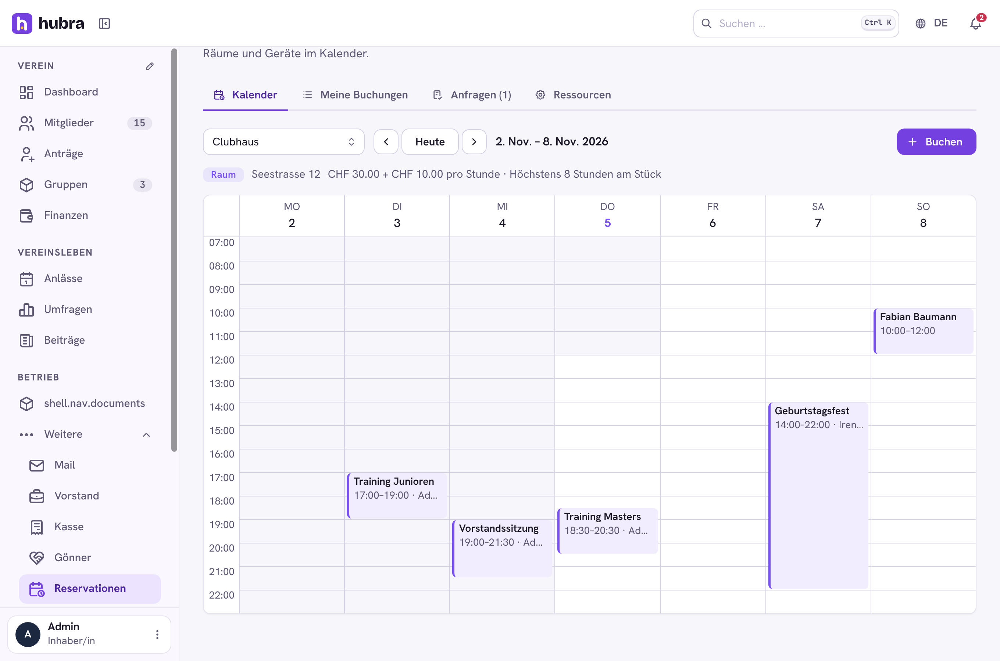

# Booking

[](https://github.com/hubra-app/hubra-plugin-booking/actions/workflows/release.yml?query=branch%3Amain) [](https://github.com/hubra-app/hubra-plugin-booking/releases/latest) [](LICENSE) [](https://buymeacoffee.com/bitsandbricks)

A plugin for [Hubra](https://hubra.club). Rooms and equipment on a calendar: members book a slot, overlapping bookings are refused, the board approves where a resource needs it, and a fee goes on the member's invoice.

**Version** 1.0.0 · **Works with** Hubra >=0.2,<1 · **Plugin id** `booking` · **Needs** the Inventory plugin (2.1 or newer) and the members and finance modules; an add-on of Inventory



## What it does

| Tab | |
| --- | --- |
| Kalender | The week of one resource (a day on the phone). Click a free hour to book it. Bookings show the title or the member's name; requests still waiting for approval are dashed and already hold the slot. |
| Meine Buchungen | The member's upcoming bookings and the last 30 days. A member cancels their own booking until it starts; an unpaid fee invoice goes with it. |
| Anfragen | Requests waiting for approval. Confirming one bills the fee; the member gets a bell notification either way. |
| Ressourcen | Rooms and equipment with a colour, a place, a fee per booking and/or per hour (with a finance category), the longest booking, how far ahead members can book, an approval switch. Equipment is an Inventory item: it is made bookable on the item's page (Reservationen), and name and place follow the item; items out of use can't be booked. |

Approvers can book for another member and repeat a booking weekly (up to
52 weeks); cancelling one booking of a series can cancel the rest too.
Times are the club's wall-clock time (`MAIL_TIMEZONE`, Europe/Zurich by
default).

Permissions: `booking.resources.update`, `booking.bookings.update`. Every
member can see the calendar and book.

## Install

Platform admins install it from the Plugin catalogue in manage
(official Marketplace, <https://plugins.hubra.club/index.json>, signed with
the Hubra project key). Clubs then switch it on under Einstellungen → Module.

## Develop

Clone this repository into `plugins/booking` of a Hubra checkout. Its tests
then run with Hubra's (`cd app/backend && pytest ../../plugins/booking`), and
`npm run build:plugin` in `app/frontend` builds its frontend. The workflow
does the same against Hubra's `main` on every push and pull request.

## Releasing

Bump `version` in `plugin.yaml`, add a `## <version>` section to
`CHANGELOG.md` and merge. Then tag the merged commit on main and push the tag:

```sh
git switch main && git pull
git tag v<version> && git push origin v<version>
```

The workflow tests the plugin and builds its frontend, the `plugin-signing`
job signs it after your approval, and only then is the GitHub release
`v<version>` published, with `booking-<version>.zip` and its `.sha256` attached.
Files listed in `.releaseignore` stay out of the zip. Releases are immutable,
so a published version never changes: fix a bad one with a new version.

Source: <https://github.com/hubra-app/hubra-plugin-booking>
